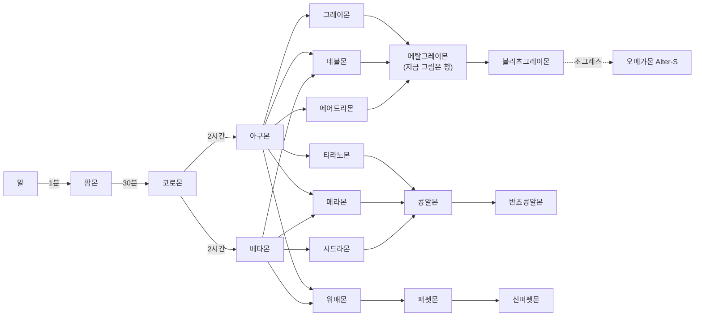

# 현재 진화트리 (게임 코드 기준)

2026-11-24 기준 `game.py`에 실제로 들어가 있는 내용입니다. 기획서(`진화트리.md`)보다 이 문서가 최신입니다.

## 1. 한눈에 보기

- 알에서 코로몬까지는 시간만 지나면 자랍니다. 아구몬과 베타몬 중 어느 쪽이 될지는 무작위입니다.
- 성장기부터는 전투 결과로만 진화합니다.

## 2. 단계별 진화 조건

| 단계 | 진화까지 | 판정 |
|---|---|---|
| 알 | 1분 | 시간만 |
| 유아기 (깜몬) | 30분 | 시간만 |
| 유년기 (코로몬) | 2시간 | 시간만, 아구몬·베타몬 무작위 |
| 성장기 | 72전 (약 12시간, 하루 9시간 기준 1.3일) | 아래 3장의 갈래 판정 |
| 성숙기 | 144전 (약 24시간, 2.7일) | 승률 53% 이상이면 진화, 아니면 은퇴 |
| 완전체 | 216전 (약 36시간, 4일) | 승률 53% 이상이면 진화, 아니면 은퇴 |
| 궁극체 | 끝 | 블리츠그레이몬만 조그레스 가능 |

시간은 펫이 화면에 나와 있는 활동 시간(08~17시, PC 켜져 있을 때)만 셉니다. 전투는 10분마다 1번입니다.

## 3. 성장기 → 성숙기 갈래

판정에 쓰는 값은 세 가지입니다.

- **패배 수**: 성장기 72전 중 진 횟수. 기준은 32패입니다.
- **두드러진 능력치**: 근력·체력·민첩 중 평균 대비 가장 높은 것입니다. 값은 기본 + 노력 + 계승으로 셉니다. 평균은 근력 28, 체력 27, 민첩 22입니다.
- **능력치 합**: 세 능력치의 합입니다. 기준은 70입니다.

### 아구몬

| 패배 | 조건 | 결과 |
|---|---|---|
| 32패 이하 | 민첩이 두드러짐 | 데블몬 |
| 32패 이하 | 그 밖 | 그레이몬 |
| 33패 이상 | 능력치 합 70 미만 | 워매몬 |
| 33패 이상 | 근력이 두드러짐 | 메라몬 |
| 33패 이상 | 민첩이 두드러짐 | 에어드라몬 |
| 33패 이상 | 체력이 두드러짐 | 티라노몬 |

### 베타몬

| 패배 | 조건 | 결과 |
|---|---|---|
| 32패 이하 | 민첩이 두드러짐 | 데블몬 |
| 32패 이하 | 그 밖 | 메라몬 |
| 33패 이상 | 능력치 합 70 이상 | 시드라몬 |
| 33패 이상 | 능력치 합 70 미만 | 워매몬 |

## 4. 성숙기 이후

갈래 없이 한 줄로 이어집니다. 단계마다 승률 53%를 넘기면 다음으로 가고, 못 넘기면 그 모습으로 은퇴하고 새 알로 시작합니다.

| 성숙기 | → 완전체 | → 궁극체 |
|---|---|---|
| 그레이몬, 데블몬, 에어드라몬 | 메탈그레이몬 | 블리츠그레이몬 |
| 티라노몬, 메라몬, 시드라몬 | 콩알몬 | 반쵸콩알몬 |
| 워매몬 | 퍼펫몬 | 신퍼펫몬 |

**조그레스**: 블리츠그레이몬이 요청 코드를 만들고, 친구의 궁극체가 응답하면 오메가몬 Alter-S가 됩니다. 친구도 블리츠그레이몬이면 둘 다 오메가몬이 됩니다.

## 5. 종 목록

종족 성향은 근력 / 체력 / 민첩 배율입니다. 1.0이 보통이고, 진화할 때 종족 보너스로 붙습니다.

| 이름 | 단계 | 타입 | 성향 (근 / 체 / 민) | 그림 폴더 |
|---|---|---|---|---|
| 깜몬 | 유아기 | 바이러스 | 1.0 / 1.0 / 1.0 | `botamon` |
| 코로몬 | 유년기 | 바이러스 | 1.0 / 1.0 / 1.0 | `koromon` |
| 아구몬 | 성장기 | 바이러스 | 1.2 / 1.0 / 0.8 | `agumon` |
| 베타몬 | 성장기 | 바이러스 | 0.8 / 1.2 / 1.0 | `betamon` |
| 그레이몬 | 성숙기 | 백신 | 1.4 / 1.2 / 0.9 | `greymon` |
| 데블몬 | 성숙기 | 바이러스 | 1.1 / 1.0 / 1.4 | `devimon` |
| 에어드라몬 | 성숙기 | 백신 | 1.0 / 0.8 / 1.3 | `airdramon` |
| 티라노몬 | 성숙기 | 데이터 | 1.1 / 1.2 / 0.7 | `tyrannomon` |
| 메라몬 | 성숙기 | 데이터 | 1.3 / 0.8 / 1.0 | `meramon` |
| 시드라몬 | 성숙기 | 데이터 | 0.9 / 1.3 / 0.9 | `seadramon` |
| 워매몬 | 성숙기 | 바이러스 | 0.6 / 0.9 / 0.6 | `numemon` |
| 메탈그레이몬 (지금 그림은 청) | 완전체 | 백신 | 1.4 / 1.3 / 1.0 | `metalgreymon_blue` |
| 콩알몬 | 완전체 | 데이터 | 1.2 / 0.9 / 1.0 | `mamemon` |
| 퍼펫몬 | 완전체 | 백신 | 0.7 / 1.0 / 0.8 | `monzaemon` |
| 블리츠그레이몬 | 궁극체 | 바이러스 | 1.4 / 1.2 / 1.1 | `blitzgreymon` |
| 반쵸콩알몬 | 궁극체 | 데이터 | 1.2 / 1.0 / 0.9 | `banchomamemon` |
| 신퍼펫몬 | 궁극체 | 백신 | 0.9 / 1.2 / 1.0 | `shinmonzaemon` |
| 오메가몬 Alter-S | 궁극체 | 바이러스 | 1.5 / 1.5 / 1.3 | `omegamon_alter_s` |

그림 폴더는 모두 `resource/디지몬/` 아래에 있습니다. 푸니몬(`punimon`)은 그림만 있고 아직 트리에 없습니다.

## 6. 트리를 나누기 전에 정할 것

지금은 그레이몬·데블몬·에어드라몬 세 갈래가 모두 같은 메탈그레이몬(청)으로 모입니다. 일반 메탈그레이몬을 추가하면서 트리를 나누려면 아래를 정해야 합니다.

1. **누가 어느 메탈그레이몬으로 가나.** 예를 들어 그레이몬은 일반, 데블몬과 에어드라몬은 청으로 나눌 수 있습니다.
2. **두 메탈그레이몬의 타입과 성향.** 지금 청이 백신으로 들어가 있습니다. 일반을 백신으로 두면 청은 바이러스로 바꿀지 정해야 합니다.
3. **두 메탈그레이몬 각각의 궁극체.** 지금은 블리츠그레이몬 하나입니다. 둘 다 블리츠그레이몬으로 갈지, 하나는 다른 궁극체로 갈지 정해야 합니다.
4. **조그레스.** 지금은 블리츠그레이몬만 요청할 수 있습니다. 갈래가 늘면 누가 요청하고 누가 응답할 수 있는지 다시 정해야 합니다.
5. **그림 폴더 이름 (정리됨).** 청은 `metalgreymon_blue`(375~389, 게임에서 쓰는 중), 일반은 `metalgreymon`(`metalgreymon_1`~`15`, 아직 게임에 연결 안 됨)입니다.

이 결정에 따라 출현 확률과 승률 균형도 달라집니다. 정해지면 시뮬레이션으로 다시 확인하겠습니다.
